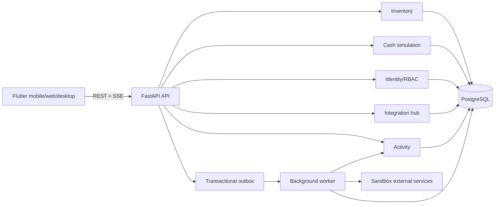
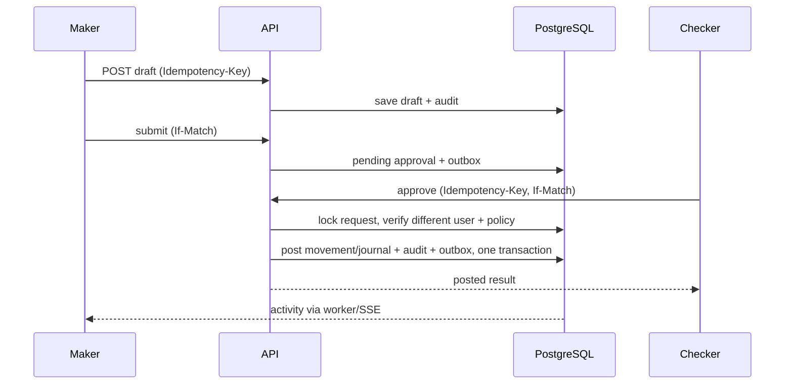

# 03 — Kiến trúc modular monolith

## Thành phần



## Module boundaries

`identity`, `inventory`, `cash_sim`, `approvals`, `integrations`, `jobs`, `activity`, `audit`, `reporting`, `shared`. Module khác chỉ gọi public service/port; không đọc bảng riêng tùy tiện. `inventory` và `cash_sim` có transaction, approval type và ledger riêng. Reporting đọc view/read model; không ghi vào module nghiệp vụ. Một PostgreSQL cluster và một deployable codebase backend; worker là process khác dùng cùng package.

## Layout đề xuất

```text
backend/app/{api,core,modules/{identity,inventory,cash_sim,approvals,integrations,jobs,activity,audit,reporting},db}
backend/alembic/versions
frontend/lib/{app,core/{api,auth,design,router},features/{dashboard,inventory,assets,cash_sim,approvals,integrations,activity}}
infra/{docker,deploy}
tests/{backend,frontend,e2e}
```

## Một command được duyệt



## Failure model

DB transaction atomic cho approval và post. Outbox giữ sự kiện trong cùng transaction; worker at-least-once, consumer idempotent theo event ID. Connector lỗi không rollback nghiệp vụ đã post; hiển thị job failed và retry có kiểm soát. Không distributed transaction với Google.
