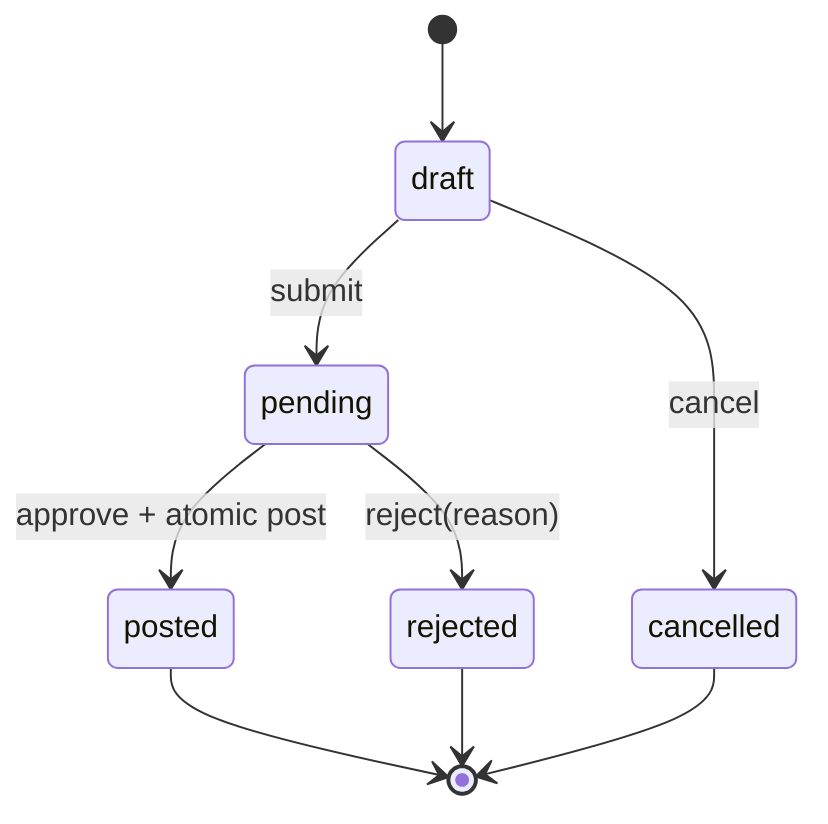

# 05 — State machine, phê duyệt, đối soát

## State machine

MVP có một checker, người khác maker. `approve` cần capability theo module, trạng thái pending, version khớp, chính sách tồn/số dư đạt. Rejected phải có lý do và yêu cầu mới nếu muốn tiếp tục. Không sửa posted; reversal hoặc adjustment là yêu cầu mới cần duyệt.

## Transaction chuẩn

1. Xác thực, RBAC, parse `Idempotency-Key` và `If-Match`.
2. Tìm kết quả idempotency cũ theo `(actor, route, key)`, trả đúng response cũ nếu payload hash trùng; khác payload trả 409.
3. `SELECT ... FOR UPDATE` request và balance cần dùng; kiểm tra trạng thái, version, maker/checker.
4. Ghi decision, movement/journal, balance, audit, outbox trong một DB transaction.
5. Commit rồi trả response; lỗi trước commit rollback toàn bộ.

Đặt unique constraints ở DB là lớp bảo vệ cuối cùng khi hai checker cùng bấm. API trả 409 `CONFLICT_VERSION`/`ALREADY_FINAL` nhất quán. Token idempotency giữ ít nhất 24 giờ, tài liệu retention trong config; journal unique theo request bảo vệ lâu dài.

## Đối soát

- Hàng ngày hoặc chạy tay: so tổng movements với `inv_balances`; so tổng journal entries với `cash_balances`.
- So danh sách asset active với vị trí/serial; kiểm tra double assignment.
- Kết quả gồm `matched`, `exception`, `running`, `failed`; exception có expected, actual, source IDs, người xử lý, thời điểm.
- Không tự động vá sai lệch. Auditor xem; operator tạo adjustment/reversal có hai người duyệt. Chạy lại sau xử lý và lưu cả hai run.

## Mẫu lỗi nghiệp vụ

`INSUFFICIENT_STOCK`, `INSUFFICIENT_SIM_CASH`, `SELF_APPROVAL_FORBIDDEN`, `INVALID_STATE`, `CONFLICT_VERSION`, `IDEMPOTENCY_KEY_REUSED`, `DUPLICATE_SERIAL`, `RECONCILIATION_EXCEPTION`.
