# 09 — Integration hub, background jobs, SSE

## Connector model

`connection` có type, tên, status, secret_ref, config đã validate, scope dữ liệu demo, owner. Adapter chung: `test_connection`, `discover_schema`, `preview`, `run_import`, `run_export`; mỗi adapter trả kết quả typed, không gọi trực tiếp module ledger. MVP: Google Sheets sandbox, CSV/Excel upload; Apps Script qua webhook signed/allowlisted. Generic outbound webhook chỉ gửi event demo đã lọc. Không kéo dữ liệu khách hàng thật.

## Import pipeline

```mermaid
flowchart LR
  SRC[Sandbox Sheet/CSV/Excel] --> FETCH[Fetch & fingerprint]
  FETCH --> STAGE[Staging rows]
  STAGE --> VALIDATE[Validate + mapping preview]
  VALIDATE --> CONFIRM[Human confirmation]
  CONFIRM --> DRAFT[Inventory/Cash demo draft]
  DRAFT --> APPROVAL[Separate maker/checker]
  APPROVAL --> POST[Ledger/movement]
```

Sheet ID, tab, header mapping và source row key phải cấu hình. Dedup theo `(connection, source_fingerprint, source_row_key, mapping_version)`. Row lỗi không chặn mọi row nếu mode partial staging; báo số hợp lệ/lỗi và tải được error report. Import chỉ tạo draft khi admin xác nhận; draft vẫn qua approval. Export là snapshot dữ liệu demo với timestamp và schema version; không chứa secret.

## Apps Script và webhook

Đường vào `/api/v1/webhooks/{connection_id}` dùng HMAC SHA-256 của raw body + timestamp, reject replay, payload size limit, dedupe external event ID. Đường ra có retry exponential backoff + jitter, dead-letter sau ngưỡng và replay có kiểm soát. Không tin Apps Script là nguồn authoritative của tồn/số dư. Nếu Google quota hoặc service lỗi, job failed/retryable; dữ liệu đã post không bị sửa.

## Jobs

Statuses `queued/running/succeeded/failed/cancelled`; terminal state một lần. Worker claim bằng DB lock/lease, heartbeat, retry count, next_attempt; claim lại khi lease hết. Job idempotent theo job key và từng batch. Outbox dispatcher phát activity sau commit; SSE từ activity/job event store với cursor bền. Retention ví dụ 30 ngày cho activity và 7 ngày cho event replay, cấu hình và ghi rõ trong UI; khi replay hết hạn client resync REST.

## Progress semantics

`total` chỉ khi xác định số row/step; `processed` đơn điệu và ≤ total. Lưu `phase` (fetch, validate, stage, export), `message_key`, `error_code`, `started_at`, `finished_at`. SSE không là nguồn sự thật; GET job trả snapshot cuối. Nút cancel chỉ cho job chưa vào bước không thể đảo ngược; không cancel posted transaction.
