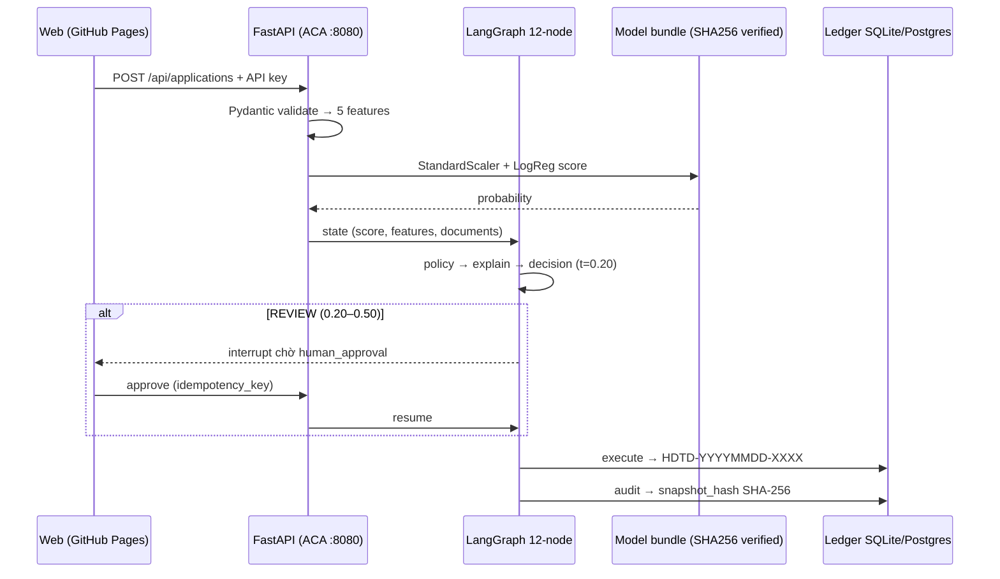
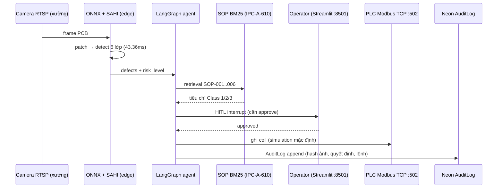
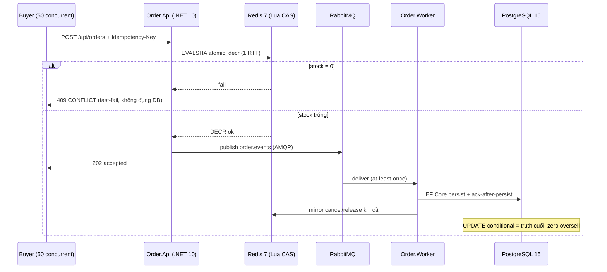
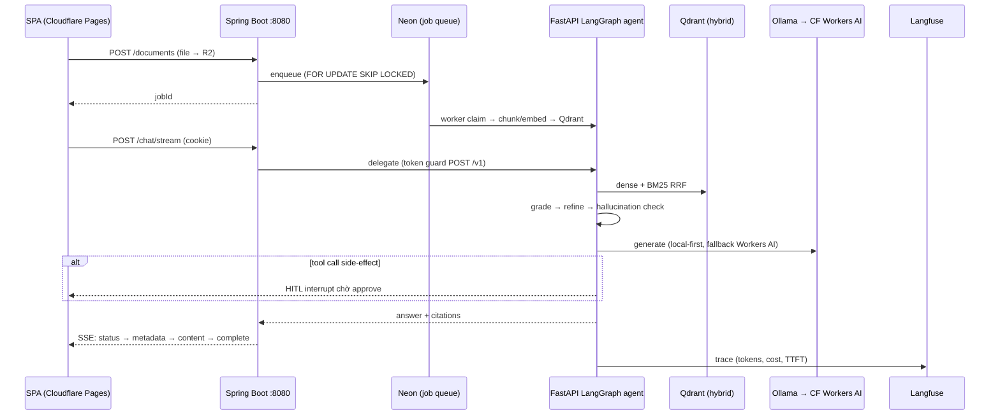
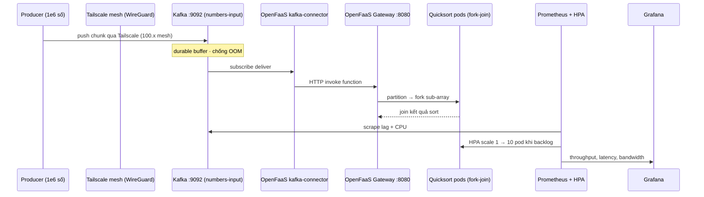

# Mô tả dự án portfolio — 5 dự án (có luồng thực thi rõ ràng)

> Dùng kèm 5 ảnh topology trong `TMA/linkedin_images/`. Mỗi dự án viết theo 5 khối:
> **Định vị → Hạ tầng cloud & DevOps → Luồng thực thi API (đánh số) → Luồng AI agent/LLM → Số liệu có thật**.
> Mọi con số/đường dẫn lấy từ repo, README hoặc kết quả CI thật — không mô tả chung chung.

---

## 1. CreditFlow — ML Credit Risk Decision Engine (MLOps)

**Định vị:** Hệ thống ra quyết định tín dụng ngân hàng chạy thật trên cloud: model ML chọn theo **cost kinh doanh** (FN=5 > FP=1), có human-in-the-loop, sổ cái audit chống sửa (SHA-256) và drift monitoring — không phải notebook demo.

### Hạ tầng cloud & DevOps
- **Frontend:** React 18 + Vite → GitHub Pages: `https://imtarget05.github.io/CreditFlow/`.
- **API:** FastAPI (Python 3.12, container port 8080) → **Azure Container Apps** `creditflow-api.blackisland-5a3f0246.southeastasia.azurecontainerapps.io`, scale 0–1, health probe `/health/live`, `/health/ready`, `/model/info`.
- **CI/CD (`.github/workflows/cd.yml`):** `test (pytest)` → `build frontend` → `deploy-azure` (`deploy/scripts/deploy-azure.sh`: deploy image + set ACA secret `CREDITFLOW_API_KEY` qua `secretref`) → `actions/deploy-pages` → `smoke` (`scripts/smoke_production.py` — fail nếu `/health/ready` chưa `status=ready`, nên release hỏng bị chặn thay vì báo success giả).
- **MLOps:** MLflow tracking (self-host); model bundle `manifest.json` + `SHA256SUMS` được verify lúc **load** (model sai checksum không vào serving). PSI drift hằng ngày so với baseline → vượt ngưỡng thì phát event `ModelDriftDetected` ra outbox.
- **Bí mật:** API key chỉ tồn tại ở GitHub Actions secret → Azure ACA secret; **frontend không nhúng key** (key cũ đã gỡ khỏi bundle Pages).

### Luồng thực thi API (end-to-end)
1. Client gọi `POST /api/applications` (header `X-CreditFlow-API-Key` — kiểm server-side).
2. **Pydantic V2 validation**: income/debts/credit history, zero-division guard.
3. **Feature engineering** 5 feature suy ra: `debt_to_income`, `loan_to_income`, `debt_to_loan`, `employment_stability`, `credit_history_year_ratio`.
4. **Serving**: `StandardScaler + logistic_regression_v001` — checksum phải khớp `SHA256SUMS` else refuse.
5. **Cost engine**: `cost = 5·FN + 1·FP`, ngưỡng tối ưu `t = 0.20` → `APPROVE` (<0.20) / `REVIEW` (0.20–0.50) / `REJECT` (≥0.50).
6. **LangGraph 12 node**: `load → validate → risk → financials → fraud → policy → explain → decision → [human_approval] → execute → audit`. Case `REVIEW` dừng ở interrupt, credit officer duyệt/duyệtture qua API rồi graph **resume**.
7. **Execute**: sinh hợp đồng `HDTD-YYYYMMDD-XXXX`; endpoint approval có reservation `PENDING_REVIEW` + `idempotency_key` chống double-click/replay.
8. **Audit**: ghi ledger + `snapshot_hash` = SHA-256 của (decision_id, application_id, decision, probability, reviewer, timestamp, model checksum) → sửa record nào cũng bị phát hiện.

### Luồng AI/LLM (giải thích, không quyết định)
- Quyết định = deterministic ML + rule engine (Rule Filter DTI/LTI) — **LLM không có quyền vote approve/reject**.
- LLM memo chạy **private vLLM/ollama nội bộ**; policy guard `CONFIDENTIAL` **chặn cứng** mọi fallback ra OpenAI/Groq/Cloudflare/Anthropic — data không bao giờ rời perimeter.
- Explainability: TF-IDF cosine inference on-prem cho mô tả tín hiệu rủi ro.

### Số liệu có thật
- Fast suite CI: **413 passed, 2 skipped** (toàn repo 426 test badge); threshold 0.20 đạt **recall 0.80** trên nhóm default; LogReg business cost **201** thắng XGBoost.
- Trạng thái production được audit công khai trong README (URL thật, việc chưa xong — user-auth cho Pages — ghi rõ thay vì che).

## 2. ApexInspect AI — Industrial Vision Inspection + Agentic SOP (Edge/OT)

**Định vị:** Hệ thống kiểm tra chất lượng PCB chạy **tại xưởng (edge)**: YOLOv8 ONNX detect lỗi → agent LangGraph chẩn đoán theo chuẩn IPC-A-610 → người duyệt → ra lệnh cho **PLC Modbus TCP** thật — có chữ ký HITL và audit log append-only.

### Hạ tầng cloud & DevOps
- **Edge (trong xưởng):** RTSP stream camera → ONNX Runtime inference (`yolov8n_pcb_defect.onnx` ~12 MB, train Colab T4, 6 lớp: missing hole, mouse bite, open circuit, short, spur, spurious copper) + SAHI micro-patching (OpenCV) → benchmark thật **43.36 ms/lớp (~23.1 FPS)** trên Apple M-series (`benchmark_results.json`, 20 lần đo sau 5 warm-up).
- **OT bridge:** client **Modbus TCP :502** (`PLCBridge`) + `VirtualModbusServer` giả lập; mặc định `APEX_PLC_MODE=simulation` — deployment mặc định **không bao giờ chạm PLC thật**, lỗi ghi phần cứng không bao giờ bị "giả thành success".
- **Cloud:** FastAPI `InspectionService :8000` (auth bằng `API_KEY`, mở khóa `POST /api/v1/mes/action`) → **Neon PostgreSQL** bảng `AuditLog` append-only (frame timestamp, hash ảnh lỗi, quyết định operator, lệnh PLC); LLM qua **Groq**; dashboard tĩnh (Render Static Site, HTML/CSS/JS không build); Streamlit console `:8501` chỉ chạy local/Docker.
- **CI/CD:** `ci.yml` = pytest + Docker image build smoke; `cd.yml` = push image **GHCR** `ghcr.io/imtarget05/apexinspect-ai:latest` → trigger **Render** deploy (autoDeploy + API call). Secret `DATABASE_URL`/`GROQ_API_KEY`/`API_KEY` đặt ở Render dashboard, **không bao giờ trong GitHub**. (Honest note trong README: Render free tier đang 503 — demo bằng `docker compose`, không trích link này khi ứng tuyển.)

### Luồng thực thi (chuỗi kiểm tra 1 frame)
1. Camera RTSP đưa frame PCB trên băng chuyền (4K).
2. **SAHI High-Res patching** cắt frame → ONNX Runtime detect → toạ độ + confidence 6 lớp.
3. Frame/defect gửi vào **LangGraph StateGraph**, state `{frame_id, defects, risk_level, operator_decision}`.
4. **BM25 retrieval** trên `data/sops/SOP-001..006` (IPC-A-610 Class 1/2/3) → agent chẩn nguyên nhân, đề xuất hành động khắc phục.
5. Case rủi ro cao → **HITL interrupt**: operator xem gallery (bounding box overlay) trên Streamlit/dashboard, xác nhận `approve/reject`.
6. Sau approve → `PLCBridge` ghi coil Modbus (vd `0x00001` emergency stop / diverters / andon tower) — simulation mode thì ghi vào virtual PLC.
7. Gọi `POST /api/v1/mes/action` (header `API_KEY`) đồng bộ với **MES**.
8. Mọi bước ghi `AuditLog` append-only ở Neon (hash ảnh + timestamp + quyết định + lệnh PLC) → truy vết được frame nào khiến coil nào đổi.

### Số liệu có thật
- ONNX benchmark: **43.36 ms / 23.1 FPS** (20 samples, 5 warm-up, input `[1,3,640,640]`) — ghi rõ là benchmark máy local, không phải SLA production.
- `APEX_PLC_MODE=simulation` mặc định; test suite + Docker build chạy trong CI; model card (`models/MODEL_CARD.md`) ghi provenance/IO shape/ngưỡng.

## 3. FlashSale Backend — Nền tảng bán flash-sale chống oversell (.NET 10)

**Định vị:** Backend event-driven xử lý "50 người mua giành 10 suất" — **đúng 10 đơn thành công, 40 đơn fast-fail trung thực**, và invariant đó được CI kiểm lại mỗi lần build (invariant sai = build fail).

### Hạ tầng cloud & DevOps
- **Kiến trúc Clean Architecture** 4 tầng bắt buộc: `Domain ← Application ← Infrastructure ← Api/Worker`; test `tests/UnitTests/ArchitectureTests.cs` **fail build** nếu đảo chiều phụ thuộc.
- **Service:** `Order.Api` (ASP.NET Core, demo `:5099`, idempotency middleware) + `Order.Worker` (daemon quét payment timeout) + **PostgreSQL 16** `FlashSaleDb` + **Redis 7** + **RabbitMQ 3.12**; runtime cách ly trên Docker network `portfolio-net`.
- **CI gate (không phải decoration):** job `concurrency-harness` chỉ pass khi in `RESULT: PASS` (zero-oversell invariant); `EndpointAuthorizationGuardTests` kiểm **tại source** mọi route đều gắn policy `StaffOrAdmin` — thiếu policy là build fail.
- **Vận hành:** backup `pg_dump -Fc` + SHA-256 + restore smoke test (ADR-008/009); pool cap **80 < 100** connection của server để luôn chừa headroom cho operator; Prometheus scrape `:5000/metrics` → Grafana dashboard (throughput, pool usage, p95/p99).
- **Bằng chứng:** `docs/adr/001-009`, `docs/benchmarks/phase2-005-*` — mỗi quyết định có ADR + số liệu đo.

### Luồng thực thi API (đơn hàng dưới tải)
1. Client `POST /api/orders` kèm header **`Idempotency-Key`** (middleware dedupe request replay).
2. **Bước 1 — Redis Lua CAS (1 round-trip atomic):** `EVALSHA atomic_decr.lua` — `stock > 0` ? DECR & success : **409 CONFLICT**. ~90% request "chỉ để nói không" bị chặn **trước khi chạm DB**.
3. **Bước 2 — nếu stock trúng:** publish message AMQP vào exchange `order.events` (RabbitMQ) → API trả 202, DB không bị đụng ở hot path.
4. **Bước 3 — `Order.Worker` consume:** persist đơn bằng EF Core (bước này mới là DB write), **ack-after-persist**; nếu event trùng (at-least-once) thì idempotency key + conditional UPDATE chặn ghi đôi.
5. **Bước 4 — PG là truth cuối cùng:** `UPDATE ... WHERE stock >= qty` atomic — cache/DB lệch thì PG vẫn không bao giờ oversell; cancel path mirror ngược về Redis.
6. **Chu kỳ thanh toán:** `POST /api/orders/{key}/pay` (owner-scope, JWT HS256) → `outcome=completed` → confirmed; gọi lại → **409** (guarded). Worker quét timer `Automation:Payment:TimeoutMinutes=15` + grace → remind → cancel → **release stock về Redis** → ghi `AutomationRuns` (audit append).
7. Observability: mọi bước phát metric → Grafana; test load **k6** (50 worker tranh 10 hàng) verify `p95 ≈ 29ms` (tiered, 1 lần đo local — ghi rõ không phải CI gate).

### Số liệu có thật
- Invariant: **50 request / stock 10 → đúng 10 sale, stock = 0** — chạy lại mỗi CI.
- **167 unit + 60 integration** tests green; p95 **29ms** (tiered) vs **574ms** (naive sync, 200 concurrency) — một lần đo local, ghi rõ trong README là "re-measure before quoting".
- Tradeoff trung thực: hot-row lock → dùng Redis pre-filter; at-least-once → idempotency; cache/DB divergence → PG authoritative.

## 4. Smart Document Chatbot — Nền tảng RAG doanh nghiệp đa service (Spring Boot + LangGraph)

**Định vị:** Upload tài liệu pháp lý → hỏi tiếng Việt/Anh → trả lời **có trích dẫn, biết nói "không đủ bằng chứng"**; 5 lớp verify chống hallucination, agent LangGraph chạy HITL, LLM local-first (Ollama) với fallback Cloudflare Workers AI.

### Hạ tầng cloud & DevOps
- **Frontend:** React 18 + TypeScript (Vite) → **Cloudflare Pages** `https://smart-doc-chatbot.pages.dev` (SSE progressive rendering).
- **Object storage:** **Cloudflare R2** bucket `smart-doc-documents` (blob tài liệu, S3-compatible); upload/download qua SPA.
- **Core gateway:** **Spring Boot 3.2 / Java 17 `:8080`** — `POST /chat/stream` (SSE), `POST /documents`, `GET /jobs/{id}`; auth **HttpOnly SameSite cookie** (không để token trong localStorage), Actuator `/actuator/health`, SLF4J MDC gắn `traceId/jobId/documentId` end-to-end.
- **AI services:** Python **FastAPI + LangGraph** (agent engine) và **llm-router** — gọi qua internal token guard `POST /v1`; LLM **local-first Ollama `:11434`**, fallback **Cloudflare Workers AI** (`@cf/meta/llama-3.3-70b-instruct`, embed `@cf/baai/bge-base-en-v1.5`).
- **Data:** **Neon PostgreSQL** (Flyway `V1..V21`, user/permission/document metadata/job queue), **Qdrant Cloud** (HNSW cosine, hybrid dense + BM25 sparse qua RRF), **Keycloak** OIDC, **Langfuse Cloud** tracing (token count, USD cost, TTFT).
- **CI/CD:** GitHub Actions `ci.yml` (665 test) + `pages.yml` build frontend; `render.yaml` blueprint cho backend; **trạng thái production được audit trung thực trong README** (backend nào canonical, service nào đang down — không bịa link sống).

### Luồng thực thi API

**A. Nạp tài liệu (async, durable):**
1. SPA `POST /documents` → file lên **R2**; Spring ghi 1 dòng job vào Neon (idempotent enqueue, dedupe theo SHA-256 file hash) → trả `jobId` ngay.
2. Worker pool claim job bằng **`FOR UPDATE SKIP LOCKED`** (nhiều pod không tranh nhau), chunk + embed → ghi vector vào **Qdrant**.
3. Retry exponential-backoff; hết lượt → **DLQ** replay được; SPA poll `GET /jobs/{id}` (owner-scoped) để thấy tiến độ.

**B. Hỏi đáp (SSE):**
1. SPA `POST /chat/stream` (cookie auth) → Spring kiểm rate limit + guardrail PII/prompt-injection.
2. Route: **Agent mode là mặc định** (LangGraph multi-step), RAG là fallback — agent *suy luận*, RAG *truy xuất*.
3. **Corrective RAG 5 lớp:** `Hybrid Retrieval (Qdrant dense+BM25 RRF) → Relevance Grading → Knowledge Refinement → Hallucination Check → Answer Grading`; evidence không đủ → **abstain** kèm trích nguồn.
4. Side-effect tool call (ingest, gọi API ngoài) → **HITL interrupt**: phải có human approve mới execute.
5. Stream về client theo chuỗi event `status → metadata → content chunk(s) → complete` ( có `error` khi fail); `SseStreamManager` + `ChatDedupService` chống trùng event, `ChatDlqService` giữ event lỗi.
6. Mọi hop có MDC `traceId` → **Langfuse** trace trọn request (cost, TTFT, span LLM).

### Số liệu có thật
- **665 tests** green (CI badge); benchmark `eval/run_live_benchmark.py`: **Recall@5 96.8%** trên 31 câu hỏi legal benchmark; npm audit production deps = **0 vulnerability**.
- Đo thật: Hit@K / Recall@K / MRR có CI regression gate; phần dev-only advisory được ghi rõ "tracked, not hidden".

## 5. UIT-NT533 — Pipeline dữ liệu phân tán serverless (K3s + Tailscale + Kafka + OpenFaaS)

**Định vị:** Cụm **3 máy vật lý sau NAT** nối nhau qua VPN Tailscale, chạy K3s + Kafka + OpenFaaS — pipeline 1 triệu số được chia chunk, sort song song bằng function serverless, tự scale theo backlog. Không cần cloud trả phí, không mở cổng port-forward.

### Hạ tầng cloud & DevOps
- **Mạng:** **Tailscale (WireGuard mesh, UDP/41641)** ghép 3 nút sau NAT thành dải IP ảo phẳng `100.x.y.z` — **zero port forwarding**, control plane `k3s-master`, worker `k3s-worker-1/2`.
- **Container platform:** **K3s** (API server, etcd/kine, CoreDNS); deploy bằng manifest trong `k8s-configs/` + script trong `scripts/`.
- **Streaming:** **Apache Kafka `:9092`**, topic partition `numbers-input` — buffer bền vững, hấp thụ traffic spike, chống worker OOM.
- **Serverless compute:** **OpenFaaS Gateway `:8080`** + `kafka-connector` (subscribe topic → HTTP invoke function); function **Parallel Quicksort** (Python, fork-join trên multi-core).
- **Observability & autoscale:** **Prometheus** scrape Kafka lag + CPU → **HPA** (`target CPU > 70%` hoặc queue lag) scale function replica **1 → 10 pod** → **Grafana** dashboard (throughput node, băng thông mạng, sorting latency).

### Luồng thực thi (end-to-end)
1. **Producer** sinh **1,000,000 số ngẫu nhiên**, chia batch/chunk rồi push vào Kafka topic `numbers-input`.
2. Chunk đến **Kafka broker** (durable, partitioned) — producer chậm/worker chậm không làm sập nhau; backpressure nằm ở đây.
3. **OpenFaaS kafka-connector** subscribe topic → mỗi message gọi HTTP `POST` tới **OpenFaaS Gateway :8080**.
4. Gateway invoke function **parallel quicksort**: chia mảng thành sub-array (fork) → các replica sort song song (join) → merge kết quả.
5. **Prometheus** theo dõi lag Kafka + CPU; khi vượt ngưỡng → **HPA** scale thêm replica (đỉnh quan sát: 1 → 10 pod); khi traffic giảm → scale về.
6. Kết quả & metric chảy vào **Grafana**; network latency được đo để chọn chunk size cân bằng giữa song song hóa và chi phí serialize (bài học ghi rõ: chunk to = ít message nhưng mỗi message nặng — cân bằng bằng đo, không phỏng đoán).

### Số liệu có thật
- Quy mô: **1,000,000 số**, 3 nút K3s, HPA quan sát **1 → 10 pod**; điểm số môn: **NT533 9.5 · NT538 9.9 · IS402 8.5**.
- Repo thật: `github.com/imtarget05/UIT-NT533-distributed-system` (k3s-serverless-data-pipeline, k8s-configs, scripts).

---

## Nguyên tắc viết để mô tả không bị coi là "AI vẽ lại"

Áp dụng cho cả 5 dự án (và lần sửa sau):

1. **Mỗi claim gắn bằng chứng:** port, header, tên file, tên job CI, URL — nếu không trích được từ repo thì bỏ, không đoán.
2. **Luồng phải nối liền đầu–cuối:** request vào ở bước 1, dữ liệu nằm ở đâu ở từng bước, kết thúc ở đâu (ledger/Qdrant/PLC coil) — không để arrow trôi giữa khoảng trống như 5 ảnh topology hiện tại.
3. **Nêu tradeoff và phần chưa đạt** (Render free tier 503, Pages chưa có user-auth, benchmark local ≠ SLU CI gate) — chi tiết này khiến mô tả *chân thực*, và cũng là thứ copy template không có.
4. **Số liệu có điều kiện:** kèm cách đo ("20 samples, 5 warm-up", "1 lần đo local, re-measure before quoting").
5. **Mỗi dự án 1 công thức:** Vấn đề → Hạ tầng (đứng ở đâu) → Luồng thực thi (đánh số) → AI/LLM nằm ở node nào (không phóng to phạm vi) → Số liệu.

> Lưu ý về 5 ảnh `linkedin_images/`: bố cục hiện tại có nhiều khoảng trống giữa các box và mũi tên không nối ai với ai (giống layout AI sinh tự do). Nếu bạn muốn, bước tiếp theo là dựng lại sơ đồ theo đúng chuỗi sequence ở trên (mỗi dự án 1 sơ đồ nối liền) — gửi mình yêu cầu là làm luôn.

