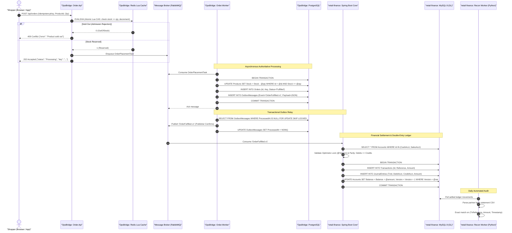
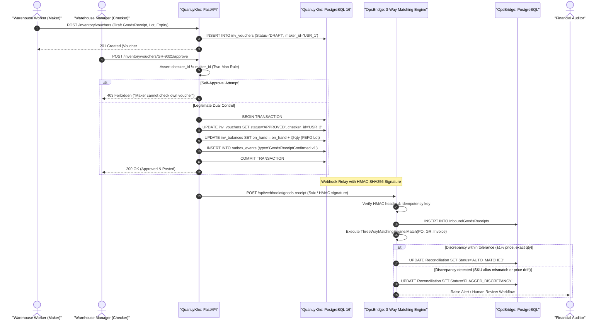
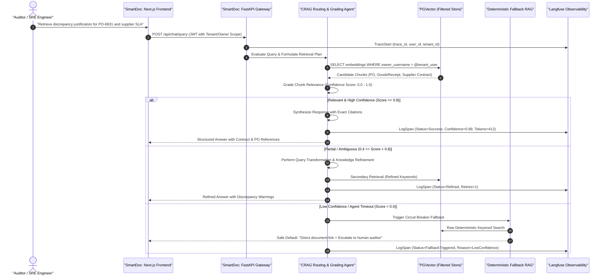
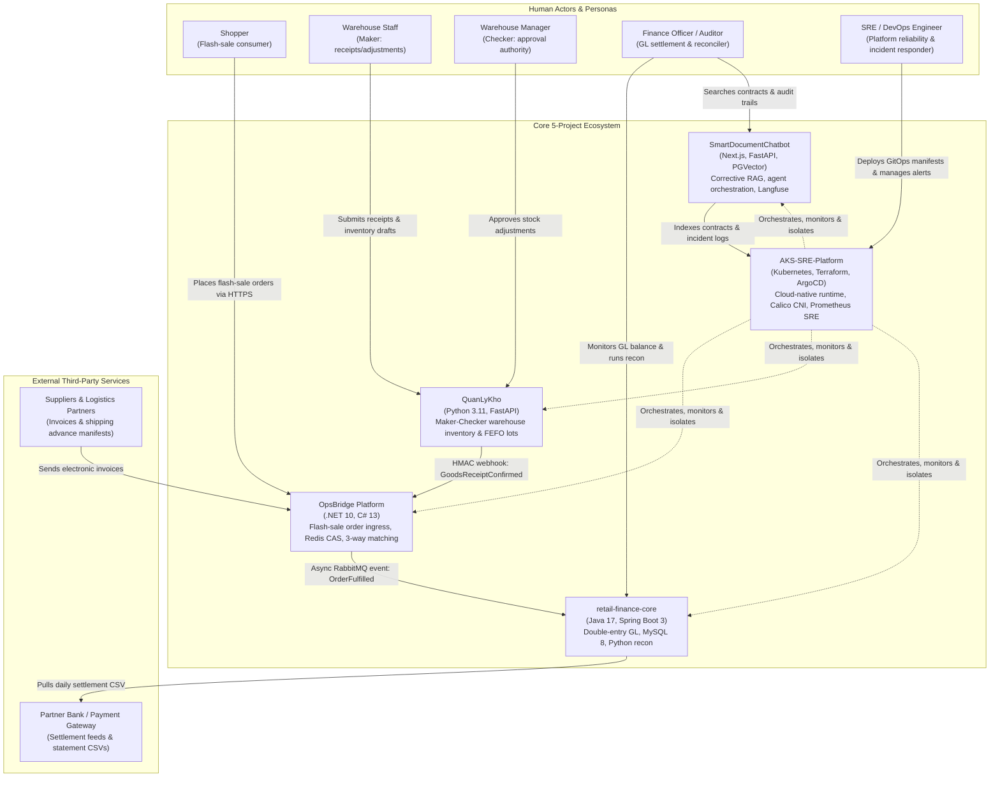
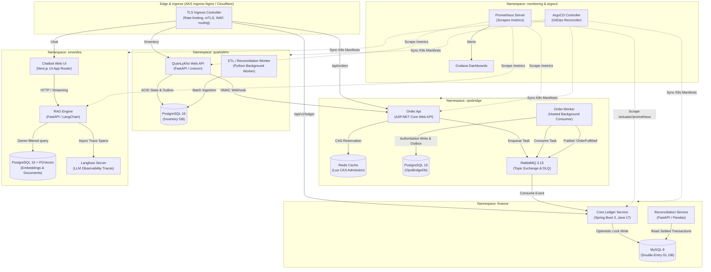
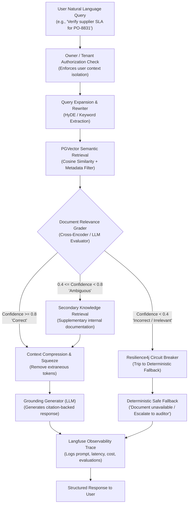

# Unified Cross-Repository Architecture & Systems Integration Guide

> **Portfolio Scope**: 5 Enterprise Systems (`OpsBridge`, `QuanLyKho`, `retail-finance-core-platform`, `AKS-SRE-Platform`, `SmartDocumentChatbot`)  
> **Target Audience**: Technical Architects, Senior/Staff Software Engineers, SRE Leads, and Technical Interviewers  
> **Key References**: [PORTFOLIO_ASSET_REGISTRY.md](../portfolio/PORTFOLIO_ASSET_REGISTRY.md), [PORTFOLIO_ARCHITECTURE_REVIEW.md](PORTFOLIO_ARCHITECTURE_REVIEW.md), [interview-diagrams.md](interview-diagrams.md)

---

## 1. Executive Portfolio Topology & Mission Matrix

The enterprise platform comprises five autonomous systems engineered to handle high-concurrency commerce, double-entry financial accounting, multi-branch physical inventory, AI document intelligence, and cloud-native GitOps delivery.

```
┌────────────────────────────────────────────────────────────────────────────────────────────────────────┐
│                                 ENTERPRISE PORTFOLIO ECOSYSTEM TOPOLOGY                                │
│                                                                                                        │
│   [ E-Commerce Shopper ]       [ Warehouse Worker & Manager ]      [ Finance Officer & Auditor ]       │
│             │                                 │                                   │                    │
│             │ HTTPS                           │ HTTPS (Maker-Checker)             │ HTTPS (mTLS)       │
│             ▼                                 ▼                                   ▼                    │
│   ┌───────────────────┐             ┌───────────────────┐               ┌───────────────────┐          │
│   │     OpsBridge     │             │    QuanLyKho      │               │  retail-finance   │          │
│   │ (.NET 10, C# 13)  │             │ (Python 3.11,     │               │ (Java 17, Spring  │          │
│   │ Flash-Sale Engine │             │  FastAPI, PG 16)  │               │  Boot 3, MySQL 8) │          │
│   └─────────┬─────────┘             └─────────┬─────────┘               └─────────▲─────────┘          │
│             │                                 │                                   │                    │
│             │ Outbox / RabbitMQ Event         │ Webhook (HMAC Svix)               │ Settled Journal    │
│             │ `OrderFulfilled.v1`             │ `GoodsReceiptConfirmed.v1`        │ Event Ingestion    │
│             └─────────────────────────────────┼───────────────────────────────────┘                    │
│                                               │                                                        │
│                                               ▼                                                        │
│                                     ┌───────────────────┐                                              │
│                                     │  SmartDocument    │                                              │
│                                     │  Chatbot (CRAG)   │                                              │
│                                     │ (Next.js/FastAPI) │                                              │
│                                     └─────────▲─────────┘                                              │
│                                               │                                                        │
│                                               │ Contract / Discrepancy Vector Search                   │
│                                               │ Langfuse Distributed Tracing                           │
│   ════════════════════════════════════════════╪════════════════════════════════════════════════════    │
│                     INFRASTRUCTURE FABRIC & RELIABILITY FOUNDATION                                     │
│                                                                                                        │
│                                     ┌───────────────────┐                                              │
│                                     │ AKS-SRE-Platform  │                                              │
│                                     │ (K8s, Terraform,  │                                              │
│                                     │  ArgoCD, Calico,  │                                              │
│                                     │  Prometheus/SRE)  │                                              │
│                                     └───────────────────┘                                              │
│               • Zero-Trust Calico CNI  • PDB Drain Tolerance  • GitOps Continuous Delivery             │
└────────────────────────────────────────────────────────────────────────────────────────────────────────┘
```

### Core Invariant & Architectural Style Comparison

| Repository | Tech Stack | Architectural Style | Core Business Mission | Primary Engineering Invariant | Concurrency & Integrity Guard |
|---|---|---|---|---|---|
| **OpsBridge** | .NET 10, C# 13, EF Core, Redis, RabbitMQ, PostgreSQL | Clean Architecture (DDD), Transactional Outbox | Flash-sale order placement & 3-way supplier reconciliation | **Zero Overselling** | Redis Lua CAS ($O(1)$) fast-fail admission + DB conditional update (`Stock >= @qty`) |
| **retail-finance** | Java 17, Spring Boot 3, MySQL 8, Testcontainers, Python | Layered Monolith (Ports & Adapters) | Core general ledger & automated bank statement reconciliation | **Double-Entry Balance** | Total Debits = Total Credits; Account version optimistic lock (`@Version`) |
| **QuanLyKho** | Python 3.11, FastAPI, SQLAlchemy 2.0, PostgreSQL 16 | Modular Monolith (Clean Architecture) | Multi-branch warehouse ingredient management & cash simulation | **Two-Man Rule (Maker-Checker)** | `maker_id != checker_id`; FEFO expiration ordering; pessimistic row lock (`FOR UPDATE`) |
| **AKS-SRE-Platform** | Kubernetes (kind / AKS), Terraform, ArgoCD, Prometheus | Cloud-Native SRE Platform, GitOps, Zero-Trust | High-reliability Kubernetes runtime, GitOps delivery, observability & DR | **Zero-Downtime Resilience** | PDB drain tolerance; Calico zero-trust isolation; non-root pods; GitOps auto-sync |
| **SmartDocumentChatbot** | Next.js 14, FastAPI, LangChain/LlamaIndex, PostgreSQL | Service-Oriented (Microservices) | Document intelligence, corrective RAG (CRAG) & incident Q&A | **Multi-Tenant Isolation** | Owner-filtered vector retrieval; Resilience4j circuit breaker fallback; Langfuse tracing |

---

## 2. Cross-Repository End-to-End Lifecycles (Gap 1)

### 2.1 Lifecycle A: High-Throughput Flash Sale to Authoritative GL Settlement

When thousands of customers compete for limited inventory during a flash sale, the transaction must pass from high-throughput admission control to asynchronous fulfillment, transactional event publishing, and final immutable double-entry general ledger recording.



#### Key Invariants Preserved
1. **Zero Oversell Invariant**: Redis is an admission gate ($O(1)$ fast-fail); PostgreSQL is the authoritative single source of truth (`Stock >= @qty`).
2. **Dual-Write Elimination**: Database mutations and `OutboxMessages` share an atomic local ACID transaction, removing the need for distributed 2-Phase Commit (2PC).
3. **Double-Entry Parity**: $\sum \text{Debits} = \sum \text{Credits}$ at the MySQL storage layer, backed by `CHECK (balance >= 0)`.

---

### 2.2 Lifecycle B: Warehouse Goods Receipt to 3-Way Reconciliation

When new stock arrives at the warehouse, it must be received under Maker-Checker dual control in `QuanLyKho`, dispatched via signed webhook, and matched against Purchase Orders and Invoices in `OpsBridge`.



#### Key Invariants Preserved
1. **Maker-Checker Dual Control**: `maker_id != checker_id` is enforced in application code and recorded immutably in audit tables.
2. **FEFO Inventory Order**: Lots are sorted by expiration date (`expired_at ASC`) so earliest-expiring inventory is consumed first.
3. **Automated 3-Way Reconciliation**: Quantities, unit costs, and SKU aliases must match within configured tolerance thresholds before supplier invoice payment is approved.

---

### 2.3 Lifecycle C: AI Operational Audit & Corrective RAG (CRAG)

When an auditor or SRE investigates an incident or discrepancy, `SmartDocumentChatbot` coordinates intelligent vector retrieval, evaluation, and fallback execution.



---

## 3. Consolidated C4 Architecture Model (Gap 2)

### 3.1 C4 Level 1: System Context Diagram

The System Context diagram establishes the organizational actors, the 5 core platforms, and external third-party services.



---

### 3.2 C4 Level 2: Container Ecosystem Diagram

The Container Diagram illustrates runtime executables, data stores, messaging brokers, and observability components.



---

### 3.3 C4 Level 3: Cross-Boundary Component Integration

This diagram details the internal mechanisms executing at the integration boundaries between systems.

```mermaid
flowchart LR
    subgraph OpsBridgeOutbox ["OpsBridge Outbox Mechanism"]
        direction TB
        AppLogic["SubmitOrderUseCase<br/>(Application)"]
        DBTx["PostgreSQL Transaction<br/>(AppDbContext)"]
        OutboxTable[("outbox_messages<br/>Table")]
        PublisherHost["OutboxPublisherHostedService<br/>(Infrastructure)"]
        RabbitExchange["RabbitMQ Topic Exchange<br/>'flashsale.events'"]

        AppLogic -->|1. Mutate Aggregate| DBTx
        DBTx -->|2. Write Event in same ACID Tx| OutboxTable
        OutboxTable -->|3. Polled via SKIP LOCKED| PublisherHost
        PublisherHost -->|4. At-least-once publish with Publisher Confirms| RabbitExchange
    end

    subgraph FinanceIngestion ["Retail Finance Ingestion & GL Guard"]
        direction TB
        EventListener["RabbitMQ Consumer<br/>(OrderSettledListener)"]
        DedupInbox[("Idempotency Table<br/>uk_txn_idempotency")]
        TxManager["Spring PlatformTransactionManager<br/>(READ_COMMITTED)"]
        AccountEntity["Account Aggregate<br/>(@Version optimistic lock)"]
        JournalEntity["JournalEntry<br/>(Debit/Credit parity constraint)"]

        RabbitExchange -->|5. Deliver message| EventListener
        EventListener -->|6. Check duplicate| DedupInbox
        EventListener -->|7. Enlist Transaction| TxManager
        TxManager -->|8. Verify @Version| AccountEntity
        TxManager -->|9. Enforce Debits == Credits| JournalEntity
    end
```



---

## 4. AKS-SRE Infrastructure Connectivity & Zero-Trust Mesh (Gap 3)

The platform hosts all 5 workloads across isolated Kubernetes namespaces, enforcing strict zero-trust ingress/egress policies via Calico CNI, zero-downtime rolling upgrades via PodDisruptionBudgets (PDB), and automated GitOps deployment via ArgoCD.

### 4.1 Namespace Layout & Cluster Topography

```text
Cluster: aks-production-cluster (Region: southeastasia / 3 Availability Zones)
├── kube-system / calico-system
├── ingress-nginx                 (External Edge LoadBalancer + TLS Termination)
├── argocd                        (GitOps Control Plane — Application-of-Applications)
├── monitoring                    (Prometheus, Grafana, Alertmanager)
├── opsbridge                     (Order.Api, Order.Worker, Redis, PostgreSQL, RabbitMQ)
├── quanlykho                     (FastAPI App, Celery/Worker, PostgreSQL 16)
├── finance                       (Spring Boot Core, MySQL 8, Python Recon Worker)
└── smartdoc                      (Next.js Frontend, FastAPI CRAG Engine, PGVector, Langfuse)
```

### 4.2 Calico Zero-Trust Network Policy Matrix

To prevent lateral movement during a security compromise, inter-namespace network traffic is blocked by default (`DefaultDeny`). Communication between components is explicitly whitelisted.

| Source Namespace / Pod | Destination Namespace / Pod | Protocol & Port | Architectural Purpose | Policy Status |
|---|---|---|---|---|
| `ingress-nginx` | `opsbridge/order-api` | TCP 8080 (HTTP) | Public customer order submission | **ALLOWED** |
| `ingress-nginx` | `quanlykho/api` | TCP 8000 (HTTP) | Warehouse management interface | **ALLOWED** |
| `ingress-nginx` | `finance/core` | TCP 8080 (HTTP) | Finance back-office & audit API | **ALLOWED** |
| `ingress-nginx` | `smartdoc/frontend` | TCP 3000 (HTTP) | Auditor chatbot interface | **ALLOWED** |
| `opsbridge/order-worker` | `finance/core` | ANY | Direct HTTP invocation | **DENIED** (Must use broker) |
| `opsbridge/order-worker` | `opsbridge/rabbitmq` | TCP 5672 (AMQP) | Order event publishing | **ALLOWED** |
| `finance/core` | `opsbridge/rabbitmq` | TCP 5672 (AMQP) | Consume `OrderFulfilled` events | **ALLOWED** |
| `quanlykho/api` | `opsbridge/order-api` | TCP 8080 (HTTP) | Inbound HMAC GoodsReceipt webhook | **ALLOWED** (mTLS/HMAC) |
| `smartdoc/api` | `finance/mysql` | TCP 3306 (MySQL) | Direct database access | **DENIED** (Zero cross-DB queries) |
| `smartdoc/api` | `smartdoc/pgvector` | TCP 5432 (Postgres) | Vector similarity search | **ALLOWED** |
| `monitoring/prometheus` | All Namespaces / Pods | TCP 8080/8000/9090 | Scrape `/metrics` & `/actuator` | **ALLOWED** (Scrape-only) |

#### Concrete Calico NetworkPolicy Manifest Example
```yaml
apiVersion: projectcalico.org/v3
kind: NetworkPolicy
metadata:
  name: isolate-finance-db
  namespace: finance
spec:
  selector: app == 'finance-mysql'
  types:
    - Ingress
    - Egress
  ingress:
    # ONLY the Java Spring Boot backend in the same namespace may connect to MySQL
    - action: Allow
      protocol: TCP
      source:
        selector: app == 'finance-core'
      destination:
        ports:
          - 3306
  egress:
    - action: Deny
```

### 4.3 GitOps Delivery & SRE Reliability Runbooks

1. **GitOps Synchronization**: ArgoCD continuously reconciles cluster state against `kubernetes/base/` and `kubernetes/overlays/production/`. Drift is corrected automatically.
2. **PodDisruptionBudget (PDB) Drain Tolerance**: Every critical deployment (`Order.Api`, `QuanLyKho`, `FinanceCore`) declares `minAvailable: 1` or `maxUnavailable: 25%`. During node drain or cluster upgrades, zero HTTP requests are dropped.
3. **Automated SRE Alert Routing**:
   - `HighOversellAnomaly`: Triggered if Redis CAS count diverges from Postgres row count $\rightarrow$ Routes to `runbooks/incident-response.md`.
   - `GlParityMismatchAlert`: Triggered if $\sum \text{Debits} \ne \sum \text{Credits}$ in financial audit $\rightarrow$ Immediate severity P0 escalation.
   - `CalicoDroppedPacketBurst`: Triggered if unauthorized lateral traffic spikes $\rightarrow$ Triggers SecOps containment runbook.

---

## 5. AI Pipeline Tracing & Governance Boundary (Gap 4)

### 5.1 SmartDocumentChatbot Corrective RAG (CRAG) Workflow



### 5.2 Langfuse Distributed Tracing Data Model

Every AI retrieval and generation step emits structured telemetry correlated with the business request:

```json
{
  "traceId": "tr-9a8b7c6d-5e4f",
  "name": "CRAG_Document_Retrieval",
  "userId": "auditor_usr_44",
  "metadata": {
    "tenantId": "enterprise_retail_vn",
    "documentScope": ["purchase_orders", "supplier_contracts"],
    "circuitBreakerState": "CLOSED"
  },
  "spans": [
    {
      "name": "PGVector_Query",
      "latencyMs": 18,
      "attributes": { "topK": 5, "similarityThreshold": 0.75, "chunksReturned": 4 }
    },
    {
      "name": "Relevance_Grader",
      "latencyMs": 142,
      "attributes": { "gradingScore": 0.88, "evaluation": "CORRECT" }
    },
    {
      "name": "LLM_Synthesis",
      "latencyMs": 850,
      "attributes": { "model": "gemini-1.5-flash", "tokensPrompt": 620, "tokensCompletion": 145 }
    }
  ],
  "output": {
    "status": "SUCCESS",
    "citations": ["PO-8831.pdf#page=2", "SLA_Supplier_Vinamilk_2026.pdf#page=5"]
  }
}
```

### 5.3 QuanLyKho AI Advisory Governance Boundary (ADR-0002)

To ensure regulatory compliance and operational safety in warehouse inventory management:
1. **Advisory-Only Mandate**: AI risk assessments and demand predictions are strictly advisory (`is_advisory = True`).
2. **Zero Autonomous Approval**: AI models cannot alter voucher statuses, approve goods receipts, or issue disbursements. All state transitions require human Maker-Checker sign-off.
3. **SHA-256 Provenance Stamp**: Every advisory prediction generated by an AI model is stamped with the model weights hash and configuration checksum (`model_provenance_hash = sha256(weights + config)`), preventing untracked automated decision drift.

---

## 6. Senior / Staff Technical Interview Defense Script

### Topic 1: Concurrency & The Zero Oversell Invariant

> **Interviewer**: *"How does your system guarantee zero overselling during a flash sale when 50,000 requests hit your API in under 5 seconds?"*
>
> **Staff Engineer Defense (English)**:  
> "We enforce a two-tier admission and persistence architecture.  
> 1. **Admission Tier (Redis Lua CAS)**: Ingress requests hit a Lua script in Redis that executes atomically in memory ($O(1)$ latency). It verifies available stock, decrements it, and records the `idempotencyKey`. If stock is exhausted, the request fails fast with `409 Conflict` in 2ms without ever touching the relational database. This shields PostgreSQL from 99% of spike traffic.  
> 2. **Persistence Tier (PostgreSQL Conditional UPDATE)**: When the asynchronous worker pulls the order message, it executes `UPDATE Products SET Stock = Stock - @qty WHERE Id = @id AND Stock >= @qty`. Even in a catastrophic Redis split-brain or failover event, the relational database acts as the single source of truth. If rows affected is zero, a `StockDriftException` is thrown and the order is immediately routed to a Dead-Letter Queue (DLQ) for operator inspection, guaranteeing inventory never drops below zero."
>
> **Staff Engineer Defense (Vietnamese)**:  
> "Hệ thống áp dụng mô hình phân tách 2 tầng: **Admission Tier** và **Persistence Tier**.  
> Tầng đầu dùng Redis Lua script để kiểm tra và trừ stock nguyên tử trong RAM. Nếu hết hàng, hệ thống ngắt ngay lập tức với mã lỗi `409 Conflict` chỉ trong 2-3ms, bảo vệ cơ sở dữ liệu không bị nghẽn I/O.  
> Khi worker xử lý ngầm, nó chạy câu lệnh SQL có điều kiện: `UPDATE Products SET Stock = Stock - @qty WHERE Id = @id AND Stock >= @qty`. Cơ sở dữ liệu quan hệ luôn là thẩm quyền tối cao. Nếu xảy ra lệch dữ liệu giữa Redis và DB, câu lệnh trả về 0 row affected, hệ thống lập tức quăng `StockDriftException` và đẩy vào Dead-Letter Queue (DLQ) chứ không bao giờ retry mù quáng, bảo đảm không bao giờ bán âm."

---

### Topic 2: Dual-Write Elimination Without Distributed 2-Phase Commit (2PC)

> **Interviewer**: *"How do you ensure that when an order is created, the event is guaranteed to reach RabbitMQ without using heavy distributed 2PC transactions?"*
>
> **Staff Engineer Defense (English)**:  
> "We implement the **Transactional Outbox Pattern** with Publisher Confirms.  
> In .NET (`OpsBridge`) and Python (`QuanLyKho`), instead of writing to the database and then directly publishing to RabbitMQ—which creates a dual-write vulnerability if the broker fails or the network partitions—we write the domain entity mutation and the serialized event into an `OutboxMessages` table inside the exact same local ACID transaction.  
> A dedicated background poller (`OutboxPublisherHostedService`) queries unprocessed outbox rows using `FOR UPDATE SKIP LOCKED`, publishes them to RabbitMQ using Publisher Confirms to ensure broker persistence, and then marks the outbox row as processed. Downstream consumers employ idempotent receivers (`Inbox` table or unique request constraints), ensuring robust at-least-once delivery."
>
> **Staff Engineer Defense (Vietnamese)**:  
> "Thay vì dùng 2-Phase Commit (2PC) vừa chậm vừa dễ nghẽn distributed lock, chúng tôi sử dụng **Transactional Outbox Pattern**.  
> Việc lưu đơn hàng và ghi log sự kiện vào bảng `OutboxMessages` nằm trong cùng một local ACID transaction của PostgreSQL. Không thể có kịch bản đơn hàng lưu thành công mà sự kiện bị mất.  
> Background hosted service đọc các message chưa gửi bằng `FOR UPDATE SKIP LOCKED` và đẩy sang RabbitMQ với chế độ Publisher Confirms. Consumer phía nhận chỉ cần áp dụng Idempotency Key (bảng Inbox hoặc Unique Index) để đạt chuẩn at-least-once delivery mà vẫn tuyệt đối nhất quán."

---

### Topic 3: Zero-Trust Kubernetes Isolation & Ingress Security

> **Interviewer**: *"How do you prevent a compromised pod in your AI service from accessing the financial MySQL database in the cluster?"*
>
> **Staff Engineer Defense (English)**:  
> "We enforce defense-in-depth across Kubernetes namespaces using **Calico NetworkPolicies**.  
> By default, all namespaces enforce a `DefaultDeny` policy on both ingress and egress. The `finance` namespace explicitly declares an ingress rule allowing TCP port 3306 traffic *only* from pods carrying the label `app: finance-core`. Any egress attempt from `smartdoc` pods to MySQL is dropped at the Linux kernel packet filter level by Calico CNI before even reaching the node network interface.  
> Furthermore, all pods run with non-root user IDs, read-only root filesystems, and zero shared database credentials."

---

## 7. Architectural Verification & Health Checklist

| Verification Item | Target Repository | Method of Proof | Target Result |
|---|---|---|---|
| **Zero Oversell Harness** | OpsBridge | Concurrency Harness (50 concurrent buyers / 10 stock) | Exact 10 fulfilled, 40 fast-failed (0 oversold) |
| **Outbox Crash Window** | OpsBridge | `OutboxCrashWindowTests.cs` | 0 lost messages across worker crash simulation |
| **Maker-Checker Security** | QuanLyKho | `test_maker_checker_authorization.py` | 403 Forbidden on self-approval attempt |
| **Double-Entry Balance** | retail-finance | `TransactionServiceIT.java` (Testcontainers MySQL) | $\text{Debits} = \text{Credits}$; `@Version` lock prevents lost updates |
| **Calico Network Isolation**| AKS-SRE-Platform | Calico probe test harness (`tests/test_gates.py`) | Denied inter-namespace traffic dropped with exit 0 |
| **PDB Drain Tolerance** | AKS-SRE-Platform | `kubectl drain node` during continuous HTTP load | 0 HTTP 5xx dropped requests |
| **CRAG Circuit Breaker** | SmartDoc | Resilience4j fault injection test | Graceful degradation to deterministic keyword search |
