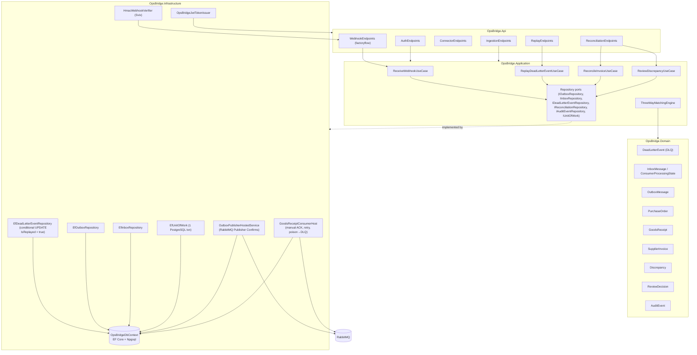

# C4 Level 3 — Component Diagram (OpsBridge bounded context)

**Ranh giới thành phần:**
- `Dom` không tham chiếu bất kỳ gói infrastructure nào (guard test `OpsBridge_Domain_MustNotReference_AnyInfrastructurePackage`).
- `App` chỉ phụ thuộc `Dom` (`OpsBridge_Application_MustDependOn_Domain`).
- `Infra` không tham chiếu `FlashSale` assembly (`OpsBridge_Infrastructure_MustNotReference_FlashSale`).
- Thứ tự tham chiếu dự án: `Domain → Application → Infrastructure → API` (`ProjectReferences_MustFollowCleanArchitectureDirection`).
