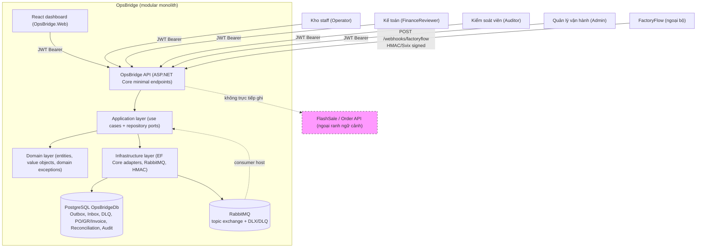

# C4 Level 2 — Container Diagram (OpsBridge)

**Chú ý kỹ thuật:** `API` không trực tiếp tham chiếu `OpsBridgeDbContext` (guard test `ApiEndpoints_MustNotDependOnInfrastructureDbContext`); persistence chạy qua Application repository ports + Infrastructure EF Core adapters trong một `IUnitOfWork` transaction.
