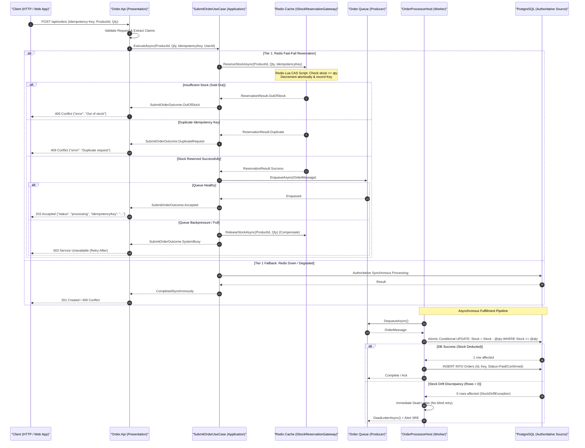
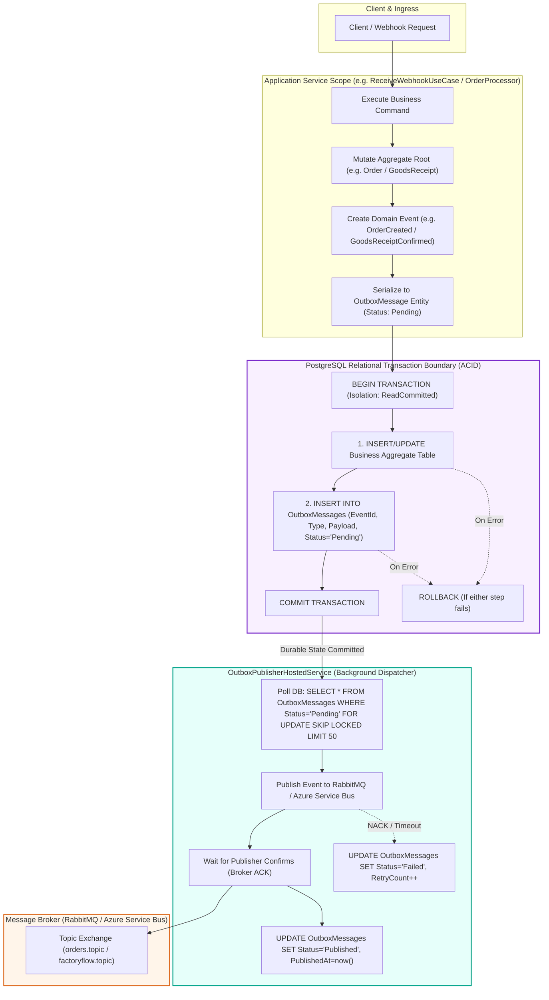
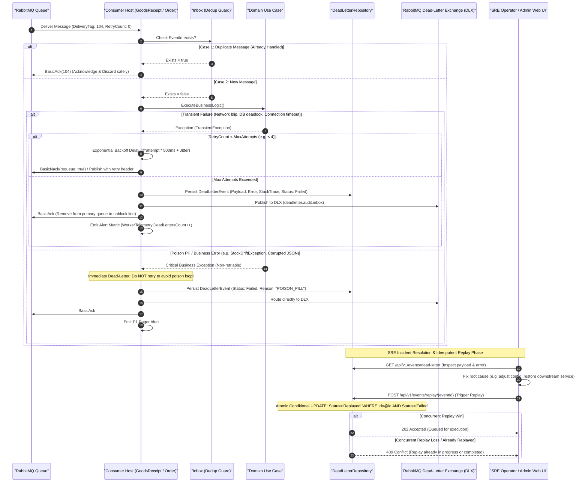

```mermaid
flowchart LR
    subgraph BoundedContext_FlashSale ["Bounded Context: FlashSale (Order Acceptance)"]
        direction TB
        ORDER_UC["OrderProcessor / SubmitOrder"]
        FS_OUTBOX["FlashSale OutboxTable"]
        FS_PUB["Outbox Dispatcher"]
        ORDER_UC -->|Commit Txn| FS_OUTBOX --> FS_PUB
    end

    subgraph MessageBroker ["RabbitMQ Enterprise Exchange Topology"]
        direction TB
        EX_TOPIC["Exchange: flashsale.events (Topic)"]
        EX_DLX["Exchange: flashsale.dlx (Fanout)"]
        
        Q_RECON["Queue: opsbridge.reconciliation.inbox"]
        Q_FULFILL["Queue: fulfillment.warehouse.inbox"]
        Q_DLQ["Queue: deadletter.audit.inbox"]
        
        EX_TOPIC -->|rk: order.created| Q_RECON
        EX_TOPIC -->|rk: order.created| Q_FULFILL
        EX_TOPIC -.->|x-dead-letter-routing-key| EX_DLX
        EX_DLX --> Q_DLQ
    end

    subgraph BoundedContext_OpsBridge ["Bounded Context: OpsBridge (Reconciliation & Ops)"]
        direction TB
        RECON_HOST["GoodsReceiptConsumerHost"]
        INBOX_REPO["EfInboxRepository (Dedup)"]
        MATCH_ENG["ThreeWayMatchingEngine (PO vs GR vs Invoice)"]
        RECON_DB["OpsBridge PostgreSQL (Independent Schema)"]
        
        RECON_HOST -->|1. Check Duplicate| INBOX_REPO
        INBOX_REPO -->|2. Not Duplicate| MATCH_ENG
        MATCH_ENG -->|3. Record Match/Discrepancy| RECON_DB
    end

    FS_PUB -->|Publish Event| EX_TOPIC
    Q_RECON -->|Consume with Prefetch=50| RECON_HOST

    style BoundedContext_FlashSale fill:#ebf8ff,stroke:#3182ce,stroke-width:2px
    style MessageBroker fill:#fffaf0,stroke:#dd6b20,stroke-width:2px
    style BoundedContext_OpsBridge fill:#f0fff4,stroke:#38a169,stroke-width:2px
```

# Distributed Systems Architecture & Interview Defense Diagrams

> **Context**: High-throughput Flash-Sale Order Reliability Platform & OpsBridge Bounded Context.  
> **Target Requirement**: Closing **G14** from the Gap Register.  
> **Source ADRs**: [ADR-001](../adr/001-reproduce-overselling-before-fixing.md), [ADR-002](../adr/002-atomic-conditional-update-for-stock.md), [ADR-003](../adr/003-redis-fast-fail-reservation.md), [ADR-004](../adr/004-async-order-fulfillment.md), [ADR-010](../adr/010-event-driven-modular-backend-before-microservices.md), [ADR-014](../adr/014-pool-headroom-backpressure-shedding.md), [ADR-015](../adr/015-transactional-outbox-and-rabbitmq-reliability.md), [ADR-016](../adr/016-three-way-reconciliation-engine.md), [ADR-017](../adr/017-opsbridge-bounded-context-foundation.md), [ADR-019](../adr/019-transactional-outbox.md).

---

## 1. Request Lifecycle & Concurrency Control (High-Throughput Ingress)

### Architecture Diagram



### Architectural Rationale & Invariants
1. **Zero Overselling Invariant**: Redis is an **optimistic admission filter** ($O(1)$ latency, ~29ms p95), while PostgreSQL is the **authoritative single source of truth**. Even in the rare event of Redis cache corruption or failover desynchronization, the database's conditional SQL guard (`UPDATE Products SET Stock = Stock - @qty WHERE Id = @id AND Stock >= @qty`) acts as a mathematical guarantee that inventory can never drop below zero.
2. **Backpressure & Compensation**: If the downstream message queue is saturated, the system avoids unbounded memory buffering by rejecting ingress requests with `503 Service Unavailable` and synchronously executing a compensating Redis stock release (`ReleaseStockAsync`).

### Interview Defense Script (Vietnamese)
> **Câu hỏi phỏng vấn**: *"Làm thế nào hệ thống của bạn xử lý 10,000 requests/giây đồng thời tranh mua 50 món hàng mà không gây sập cơ sở dữ liệu và không bán vượt (oversell)?"*
>
> **Cách trả lời (Senior/Staff level)**:
> 1. **Kiến trúc 2 tầng (Tiered Architecture)**: Tôi phân tách ranh giới rõ ràng giữa **Admission Control** (cổng lọc lưu lượng) và **Authoritative Persistence** (lưu trữ có thẩm quyền).
> 2. **Tầng 1 (Redis Lua CAS)**: Hàng nghìn request đồng thời được hấp thụ tại tầng Redis bằng Lua script nguyên tử. Request chỉ mất 2-3ms để trừ stock hoặc từ chối ngay lập tức với `409 Conflict` nếu đã hết hàng. Nhờ vậy, 99.5% lưu lượng dư thừa bị chặn trước khi chạm vào PostgreSQL.
> 3. **Tầng 2 (Async Decoupling & Atomic Conditional SQL)**: Những request hợp lệ được đưa vào hàng đợi (`OrderMessage`) và trả về `202 Accepted` cho client trong vòng 30ms. Worker background xử lý tuần tự theo batch, dùng câu lệnh điều kiện `UPDATE Products SET Stock = Stock - @qty WHERE Stock >= @qty`.
> 4. **Bảo vệ chống Stock Drift**: Nếu xảy ra bất đồng bộ giữa Redis và DB (ví dụ Redis crash phục hồi trễ), câu lệnh SQL điều kiện sẽ trả về `0 rows affected`. Hệ thống lập tức ném `StockDriftException`, ngắt luồng và đưa vào Dead-Letter Queue (DLQ) ngay lập tức chứ không retry mù quáng để tránh làm méo mó số liệu kế toán.

---

## 2. Transaction Boundary & Transactional Outbox (Dual-Write Prevention)

### Architecture Diagram



### Architectural Rationale & Invariants
1. **Elimination of the Dual-Write Hazard**: When an application writes to a database and publishes to a message broker, network partitions or process crashes between the two calls cause data divergence (e.g., database commits but publisher crashes $\rightarrow$ ghost state; or publisher succeeds but database rolls back $\rightarrow$ phantom message).
2. **Local ACID Transaction**: We write the business mutation and the outbound event to the *same* PostgreSQL database within a single local transaction. We deliberately reject distributed two-phase commit (2PC / XA transactions) because 2PC introduces blocking coordinator locks, reduces availability (CAP theorem), and degrades database throughput by up to 10x.
3. **At-Least-Once Delivery**: The background dispatcher uses `FOR UPDATE SKIP LOCKED` and waits for broker **Publisher Confirms** before updating the outbox status to `Published`. If the dispatcher dies mid-flight, the event remains `Pending` and is safely picked up on restart, guaranteeing at-least-once delivery.

### Interview Defense Script (Vietnamese)
> **Câu hỏi phỏng vấn**: *"Tại sao bạn không bắn event trực tiếp lên RabbitMQ/Kafka ngay trong API controller sau khi save DB? Làm sao bạn giải quyết vấn đề Dual-Write?"*
>
> **Cách trả lời (Senior/Staff level)**:
> 1. **Phân tích vấn đề Dual-Write**: Nếu tôi gọi `await _db.SaveChangesAsync()` rồi mới gọi `await _bus.PublishAsync()`, thì nếu tiến trình ứng dụng bị crash (OOM, restart pod) đúng vào khoảng cách giữa 2 lệnh đó, dữ liệu trong DB đã lưu nhưng broker không hề có message. Ngược lại, nếu publish trước rồi DB bị lỗi rollback, broker nhận được phantom message gây sai lệch downstream.
> 2. **Giải pháp Transactional Outbox**: Thay vì dùng giao dịch phân tán 2PC phức tạp và nghẽn cổ chai, tôi áp dụng Transactional Outbox pattern. Bảng `OutboxMessages` nằm ngay trong database của bounded context.
> 3. **Tính nguyên tử ACID**: Cả Aggregate entity và Outbox record được commit trong cùng 1 local PostgreSQL transaction. Hoặc cả hai cùng được ghi nhận, hoặc cả hai cùng rollback.
> 4. **Dispatcher độc lập**: Một background service (`OutboxPublisherHostedService`) quét các message pending dùng `SKIP LOCKED` để không lock contention, bắn lên Broker và chỉ đánh dấu `Published` khi nhận được Broker ACK (Publisher Confirms). Mô hình này đảm bảo tính bền bỉ tối đa và chấp nhận ngữ nghĩa At-Least-Once.

---

## 3. Asynchronous Message Flow & Bounded Context Decoupling

### Architecture Diagram



### Architectural Rationale & Invariants
1. **Autonomous Bounded Contexts**: `FlashSale` (đặt hàng tốc độ cao) và `OpsBridge` (đối soát kho & tài chính 3 bên) là 2 bounded context độc lập. Chúng tuyệt đối không chia sẻ DbContext hay database connection string. Sự giao tiếp duy nhất diễn ra thông qua integration events với schema định danh rõ ràng (`docs/contracts/`).
2. **Durable Inbox Pattern at Consumer**: Bounded context đích (`OpsBridge`) triển khai **Inbox Pattern** (`EfInboxRepository`). Mọi message từ broker trước khi xử lý đều được kiểm tra hash/eventId duy nhất trong database bảng `InboxMessages`. Điều này triệt tiêu hoàn toàn rủi ro duplicate do at-least-once delivery của RabbitMQ.
3. **Consumer Backpressure Control**: Worker sử dụng `BasicQos(prefetchCount: 50)`. Consumer chỉ kéo tối đa 50 messages cùng lúc, ngăn chặn tình trạng tràn bộ nhớ node và giật lag event loop.

### Interview Defense Script (Vietnamese)
> **Câu hỏi phỏng vấn**: *"Làm cách nào bạn phân tách ranh giới hệ thống giữa việc bán hàng Flash-Sale và việc đối soát vận hành kho OpsBridge? Nếu hệ thống đối soát bị chậm thì có ảnh hưởng đến việc đặt hàng không?"*
>
> **Cách trả lời (Senior/Staff level)**:
> 1. **Phân rã Domain-Driven Design (DDD)**: Đặt hàng (`FlashSale`) là tác vụ độ trễ thấp (latency-critical), còn đối soát 3 chiều (`OpsBridge ThreeWayMatchingEngine`) là tác vụ hướng tính nhất quán và quy trình nghiệp vụ (consistency-critical). Tôi tách chúng thành hai Bounded Context riêng biệt.
> 2. **Phi ghép nối hoàn toàn (Zero Coupling)**: API đặt hàng không gọi RPC/HTTP đồng bộ sang OpsBridge, cũng không dùng chung bảng cơ sở dữ liệu. Mọi tương tác đều thông qua asynchronous integration event (`order.created`, `goods_receipt.confirmed`).
> 3. **Tính chịu lỗi độc lập (Temporal Decoupling)**: Nếu service OpsBridge bị quá tải hoặc tạm dừng để bảo trì cơ sở dữ liệu, message sẽ tự động tích tụ an toàn trong RabbitMQ queue. Luồng đặt hàng flash-sale vẫn tiếp tục phục vụ khách hàng với SLA <50ms mà không hề bị block hay ảnh hưởng.

---

## 4. Failure Recovery, DLQ, Idempotency & Replay Runbook

### Architecture Diagram



### Architectural Rationale & Invariants
1. **Differentiating Transient vs Poison Pill Failures**:
   - **Transient errors** (database connection pools exhausted, transient network timeouts): Handled via exponential backoff with randomized jitter to prevent the "thundering herd" problem against downstream dependencies.
   - **Poison pills & Business rejections** (JSON parsing error, schema incompatibility, `StockDriftException`): Bypasses retry loops entirely and dead-letters immediately. Retrying a poison pill 1,000 times only burns CPU, fills logs, and blocks head-of-line messages in the queue.
2. **Idempotent Replay Guarantee (FailureDrill6)**:
   - When SRE engineers trigger a batch replay of dead-lettered events via the admin API, multiple operators or scripts might accidentally trigger the same event simultaneously.
   - We guard replay execution via an atomic conditional SQL query:
     ```sql
     UPDATE DeadLetterEvents 
     SET Status = 'Replaying', ReplayedAt = NOW(), ReplayedBy = @actor 
     WHERE Id = @eventId AND Status = 'Failed';
     ```
   - Only the exact request that updates 1 row is allowed to republish the event into the ingestion pipeline; concurrent duplicate calls receive an immediate `409 Conflict`.

### Interview Defense Script (Vietnamese)
> **Câu hỏi phỏng vấn**: *"Nếu một message trong hàng đợi bị lỗi liên tục, hệ thống của bạn làm sao để không bị nghẽn queue và không bị lặp vô tận (poison loop)? Quy trình khắc phục sự cố diễn ra như thế nào?"*
>
> **Cách trả lời (Senior/Staff level)**:
> 1. **Phân loại lỗi thông minh**: Tôi phân loại lỗi thành 2 nhóm rõ rệt: Transient (tạm thời) và Poison Pill (nghiệp vụ / dữ liệu độc hại).
> 2. **Chính sách Backoff có Jitter**: Đối với lỗi tạm thời như rớt kết nối mạng hoặc DB deadlock, consumer thực hiện retry tối đa 3 lần với thuật toán `Exponential Backoff + Jitter` để tránh thundering herd.
> 3. **Xử lý Poison Pill & StockDrift**: Đối với lỗi dữ liệu sai định dạng hoặc `StockDriftException` (độ lệch giữa Redis và DB), consumer không được phép retry vô ích. Message được chuyển ngay lập tức vào **Dead-Letter Queue (DLQ)** và bảng `DeadLetterEvents`, sau đó ACK khỏi queue chính để giải phóng head-of-line.
> 4. **Cơ chế Replay Idempotent**: SRE có thể kiểm tra danh sách DLQ qua API/Dashboard. Khi nguyên nhân gốc được khắc phục, SRE bấm replay. Thao tác replay được bảo vệ bởi câu lệnh conditional update nguyên tử `WHERE Status = 'Failed'`. Ngay cả khi 10 người cùng bấm nút replay 1 message cùng lúc, chỉ duy nhất 1 thao tác thành công, đảm bảo tính bất biến toàn vẹn dữ liệu.

---

## 5. Traceability Matrix & Code Symbol Anchors

| Diagram | Core Requirements | Architectural Invariants Enforced | Grounded Implementation Files | Test Verification Suites |
|---|---|---|---|---|
| **1. Request Lifecycle** | R1.1, R1.2, R3.1, R3.9 | Zero Oversell, Sub-50ms Admission, Fast-Fail | [Program.cs](../../src/Order.Api/Program.cs#L403-L460)<br>[SubmitOrderUseCase.cs](../../src/FlashSale.Application/Orders/SubmitOrderUseCase.cs)<br>[RedisStockGateway.cs](../../src/FlashSale.Infrastructure/Redis/RedisStockGateway.cs)<br>[OrderRepository.cs](../../src/FlashSale.Infrastructure/Persistence/OrderRepository.cs) | `OrderProcessorTests.cs`<br>`concurrency-harness` (50 buyers / 10 stock) |
| **2. Transaction Boundary** | R3.5, R3.7, ADR-019 | No Dual-Write, Atomicity, Outbox Reliability | [OutboxEventWriter.cs](../../src/FlashSale.Infrastructure/Outbox/OutboxEventWriter.cs)<br>[OutboxPublisherHostedService.cs](../../src/OpsBridge.Infrastructure/BackgroundServices/OutboxPublisherHostedService.cs)<br>[EfOutboxRepository.cs](../../src/OpsBridge.Infrastructure/Persistence/EfOutboxRepository.cs) | `OutboxCrashWindowTests.cs`<br>`FailureDrill1` (Broker down during commit) |
| **3. Async Message Flow** | R4.1, R4.4, ADR-010 | Autonomous Bounded Contexts, Prefetch Backpressure | [GoodsReceiptConsumerHost.cs](../../src/OpsBridge.Infrastructure/Messaging/GoodsReceiptConsumerHost.cs)<br>[EfInboxRepository.cs](../../src/OpsBridge.Infrastructure/Persistence/EfInboxRepository.cs)<br>[ThreeWayMatchingEngine.cs](../../src/OpsBridge.Application/UseCases/ThreeWayMatchingEngine.cs) | `SkuAliasMappingTests.cs`<br>`ThreeWayMatchingEngineTests.cs` |
| **4. Failure Recovery & DLQ** | R3.2, R3.3, R3.4, R3.6 | Idempotent Replay, Anti-Poison Loop, Fast DLQ | [OrderProcessorHost.cs](../../src/FlashSale.Infrastructure/Messaging/OrderProcessorHost.cs#L52-L58)<br>[EfDeadLetterEventRepository.cs](../../src/OpsBridge.Infrastructure/Persistence/EfDeadLetterEventRepository.cs)<br>[ReplayDeadLetterEventUseCase.cs](../../src/OpsBridge.Application/UseCases/ReplayDeadLetterEventUseCase.cs) | `FailureDrill5` (Max retry $\rightarrow$ DLQ)<br>`FailureDrill6` (Concurrent idempotent replay) |
