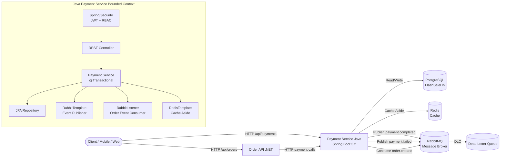

# Payment Service Java — Architecture

## Overview

The Java Spring Boot payment service is a bounded context within the FlashSale
microservices platform. It owns payment processing, idempotency, and payment
event publishing. It shares PostgreSQL, Redis, and RabbitMQ with the existing
.NET services but owns only its own `payment_records` table.

## Component Diagram



## Service Boundaries

| Boundary | Responsibility |
|----------|---------------|
| **Payment Service Java** | Payment processing, idempotency, event publishing, JWT auth |
| **Order API (.NET)** | Order lifecycle, calls payment service via HTTP |
| **Order Worker (.NET)** | Async order processing, RabbitMQ consumer |

## Data Flow — Payment Processing

```
Client → POST /api/payments → Java Controller
  → Java Service (@Transactional)
    → Check idempotency key in PostgreSQL
    → If exists: return stored result
    → If new: simulate payment (cent-based rules)
    → Save to PostgreSQL (payment_records table)
    → Return result (200 OK or 504 Gateway Timeout)
    → Publish payment.completed / payment.failed to RabbitMQ
```

## Data Flow — Event Consumption

```
RabbitMQ order.created → Java RabbitListener
  → Log event (idempotency handled at payment level)
  → No direct payment mutation from events
```

## Technology Stack

| Layer | Technology | Version |
|-------|-----------|---------|
| Language | Java | 17 |
| Framework | Spring Boot | 3.2.5 |
| Data Access | Spring Data JPA | — |
| Database | PostgreSQL | 15 |
| Cache | Redis | 7 |
| Messaging | RabbitMQ | 3 |
| Security | Spring Security + JWT (jjwt) | 6 / 0.12.3 |
| API Docs | OpenAPI / Swagger (springdoc) | 2.2.0 |
| Testing | JUnit 5, Mockito, Testcontainers | — |
| Container | Docker | multi-stage |
