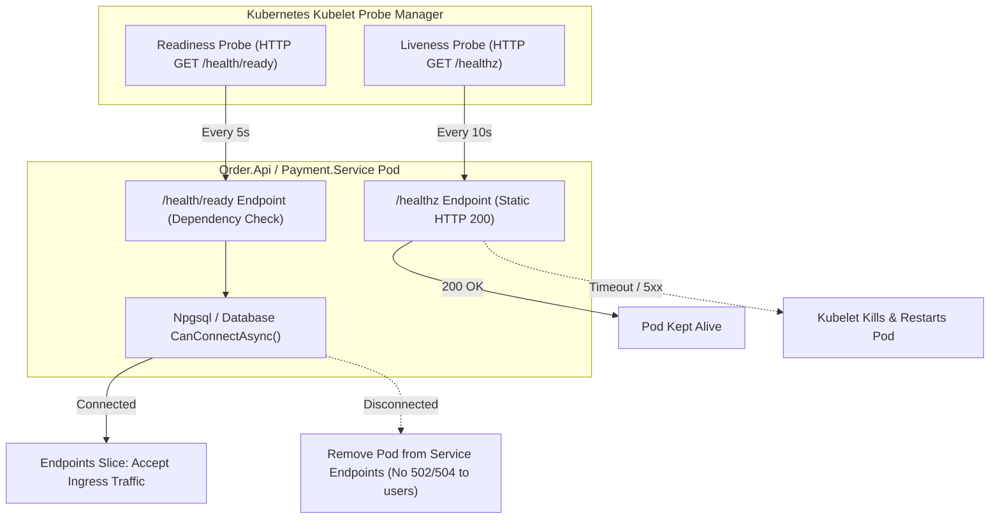

# Pod Health Probes & Payment Simulation Architecture

> **Requirement Reference**: Closes **G7** from the Gap Register.  
> **Source Documents**: [ADR-007](../adr/007-container-runtime-strategy.md), [ADR-017](../adr/017-opsbridge-bounded-context-foundation.md).

---

## 1. Kubernetes Pod Health Probes Architecture

To prevent traffic routing to booting or degraded pods and enable kubelet automatic container restarts, all core services define explicit two-tier health probes:



### 1.1 Separation of Liveness vs Readiness
1. **Liveness Probe (`/healthz` / `/health/live`)**:
   - **Purpose**: Detect internal application deadlocks, memory leaks, or thread hangs.
   - **Semantics**: Returns static `200 OK {"status":"healthy"}` without pinging external dependencies (PostgreSQL / Redis).
   - **Rationale**: If external database connectivity drops momentarily, killing the application pod solves nothing and triggers a cascade of container restarts ("crash loops"). Kubelet must only restart the container if the web process itself is hung.
2. **Readiness Probe (`/health/ready`)**:
   - **Purpose**: Determine if the pod can safely serve incoming user traffic.
   - **Semantics**: Executes an active connection check to the authoritative database (`db.Database.CanConnectAsync()`).
   - **Rationale**: If PostgreSQL is initializing or undergoing failover, the readiness probe fails (`503`), removing the pod from Kubernetes Service endpoints. This prevents clients from receiving 500 errors.

### 1.2 Kubernetes Manifest Declarations
Configured in `infrastructure/kubernetes/base/api/deployment.yaml` and `base/payment/deployment.yaml`:
```yaml
livenessProbe:
  httpGet:
    path: /healthz
    port: 8080
  initialDelaySeconds: 5
  periodSeconds: 10
readinessProbe:
  httpGet:
    path: /health/ready
    port: 8080
  initialDelaySeconds: 3
  periodSeconds: 5
```

---

## 2. Payment Service Simulation Transparency Labeling

Per **ADR-017**, `Payment.Service` is an autonomous mock payment gateway designed to verify distributed Saga idempotency, timeout compensations, and financial failure states without incurring real third-party banking transaction fees.

### 2.1 Deterministic Simulation Contract
The payment adapter inspects the fractional cents of the requested payment amount:
- **Amount ending in `.01` (or whole dollars)** $\rightarrow$ **Succeeded**: Mints transaction ID `tx_{Guid:N}`.
- **Amount ending in `.02`** $\rightarrow$ **Declined**: Simulates insufficient customer funds (`IsTransientError = false`).
- **Amount ending in `.03`** $\rightarrow$ **TimedOut**: Simulates upstream payment gateway timeout (`IsTransientError = true`), triggering Saga retry or compensation.

### 2.2 Operational Transparency
To prevent interviewers or recruiters from confusing the mock payment adapter with a live banking integration:
1. All health checks explicitly report `mode: "Simulation"`:
   ```json
   { "status": "Healthy", "service": "Payment.Service", "mode": "Simulation" }
   ```
2. All payment API responses include the standard HTTP header:
   ```http
   X-Payment-Adapter: Simulation
   ```
3. Documentation throughout the portfolio clearly designates `Payment.Service` as an in-memory/isolated PostgreSQL simulation adapter.
