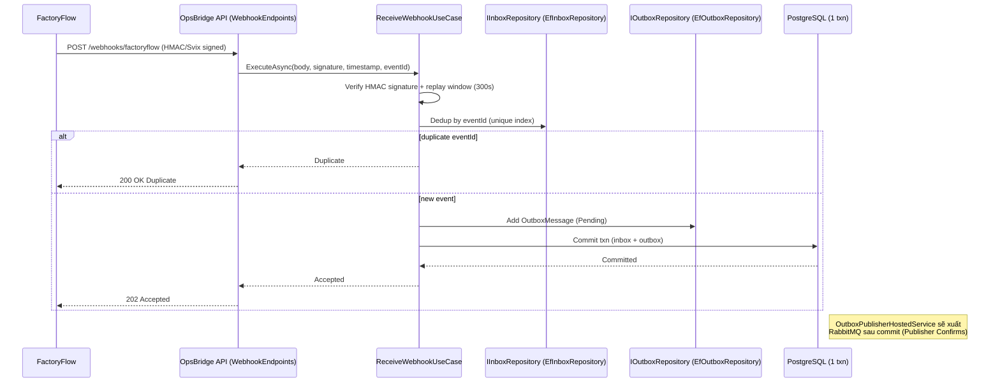

# Sequence Diagrams — luồng chính và luồng lỗi (OpsBridge)

> Grounded in actual implementation: `ReceiveWebhookUseCase`, `OutboxPublisherHostedService`, `GoodsReceiptConsumerHost`, `EfDeadLetterEventRepository`, `ReviewDiscrepancyUseCase`, `ThreeWayMatchingEngine`.

## 1. Webhook ingestion thành công (ngay cả khi brokerDown)



## 2. Replay DLQ idempotent dưới tải đồng thời (FailureDrill6)

```mermaid
sequenceDiagram
    participant O1 as Operator-1
    participant O2 as Operator-2..12 (11 requests)
    participant API as ReplayEndpoints
    participant UC as ReplayDeadLetterEventUseCase
    participant Repo as EfDeadLetterEventRepository
    participant DB as PostgreSQL

    O1->>API: POST /events/replay/{eventId}
    O2->>API: POST /events/replay/{eventId} (x11, đồng thời)
    API->>UC: ExecuteAsync(eventId, actor)
    UC->>Repo: QueueReplayAsync(eventId, actor)
    Repo->>DB: BEGIN txn; SELECT WHERE EventId=? AND !IsReplayed
    alt first request wins conditional UPDATE (IsReplaced=true)
        Repo-->>UC: updated=1 → Queued
        Repo->>DB: Add OutboxMessage; COMMIT
        UC-->>API: ReplayQueued
        API-->>O1: 200 {status:"ReplayQueued"}
    else subsequent requests see IsReplayed=true (updated=0)
        Repo-->>UC: updated=0 → AlreadyReplayed
        Repo->>DB: ROLLBACK
        UC-->>API: AlreadyReplayed
        API-->>O2: 200 {status:"AlreadyReplayed"}
    end
    note right of DB: Kết quả: 1 ReplayQueued + 11 AlreadyReplayed,<br/>đúng 1 OutboxMessage cho eventId
```

## 3. Đối soát 3-way và phê duyệt sai lệch

```mermaid
sequenceDiagram
    participant Admin as Admin (ReconcileInvoiceUseCase)
    participant Matching as ThreeWayMatchingEngine
    participant Reconc as IReconciliationRepository
    participant FR as FinanceReviewer (ReviewDiscrepancyUseCase)
    participant DB as PostgreSQL

    Admin->>Matching: Match(PO, receipts, invoice, rules, tolerance)
    Matching-->>Admin: ReconciliationResult (MATCHED or DISCREPANCY + discrepancies)
    Admin->>DB: Commit result + invoice status + audit (1 txn)
    alt có discrepancy
        FR->>DB: GET discrepancy
        FR->>DB: POST /discrepancies/{id}/review (ApproveWithTolerance)
        DB->>DB: discrepancy.Status=RESOLVED; Add ReviewDecision
        alt tất cả discrepancy trên kết quả đều Resolved
            DB->>DB: TryAllocateQuantityAsync (conditional row update)
            DB->>DB: invoice = ApprovedWithVariance
        end
        DB->>DB: Add AuditEvent; COMMIT
    end
```

## 4. Luồng lỗi: RabbitMQ down khi webhook đến (FailureDrill1)

```mermaid
sequenceDiagram
    participant FF as FactoryFlow
    participant API as OpsBridge API
    participant Broker as RabbitMQ
    participant DB as PostgreSQL Outbox

    FF->>API: POST webhook (HMAC hợp lệ)
    API->>DB: Commit inbox + outbox (Pending)
    API->>Broker: OutboxPublisher attempts publish
    alt Broker down
        Broker-->>API: connection failed
        API-->>FF: 202 Accepted (outbox đã commit)
        note right of DB: OutboxPublisherHostedService sẽ thử lại<br/>lần tiếp theo; không fake 2xx nếu persistence lỗi
    end
```
