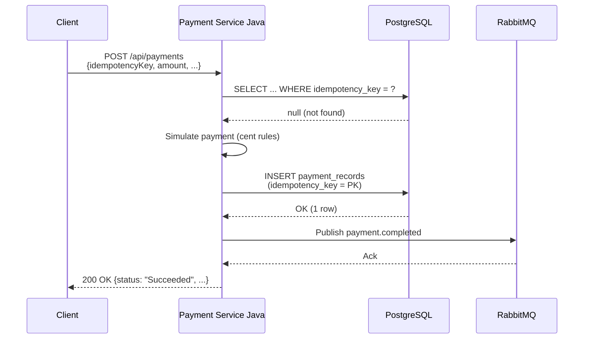
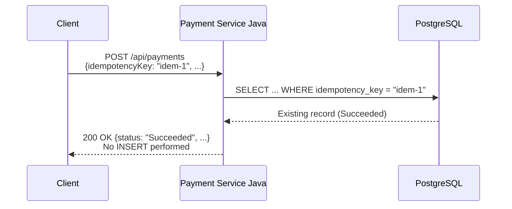
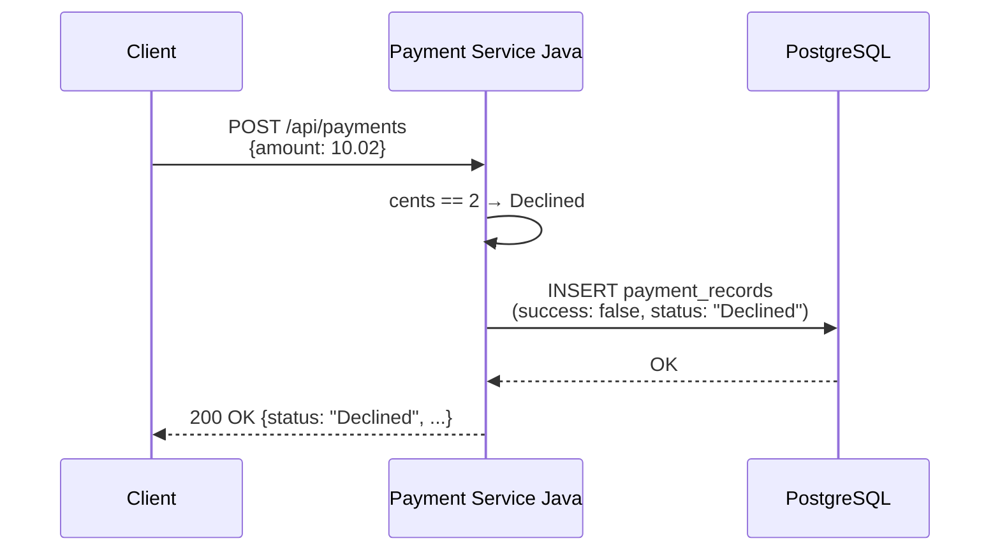
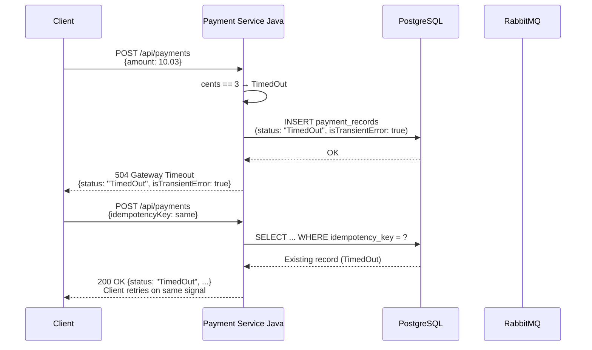
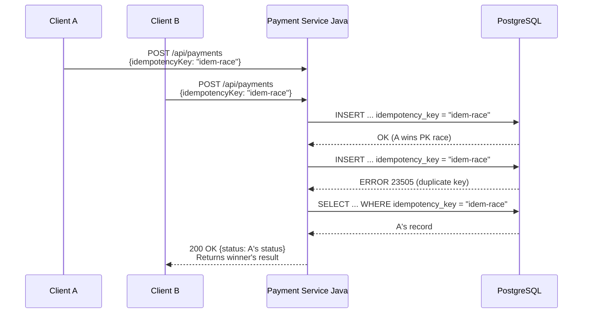
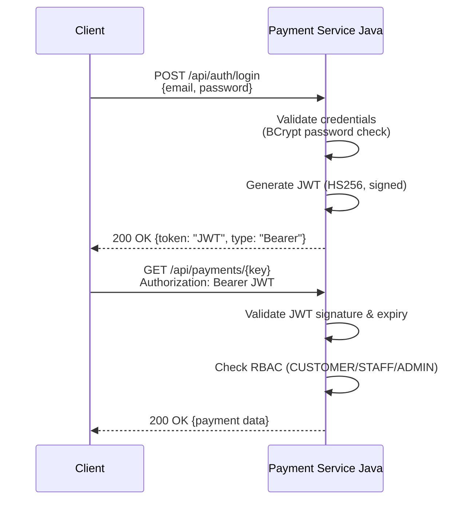

# Payment Service — Sequence Diagrams

## 1. Successful Payment Flow

## 2. Idempotent Replay (Same Key)

## 3. Declined Payment (Cent Value .02)

## 4. Transient Timeout (Cent Value .03)

## 5. Idempotency Race (Concurrent Requests)

## 6. Authentication Flow

